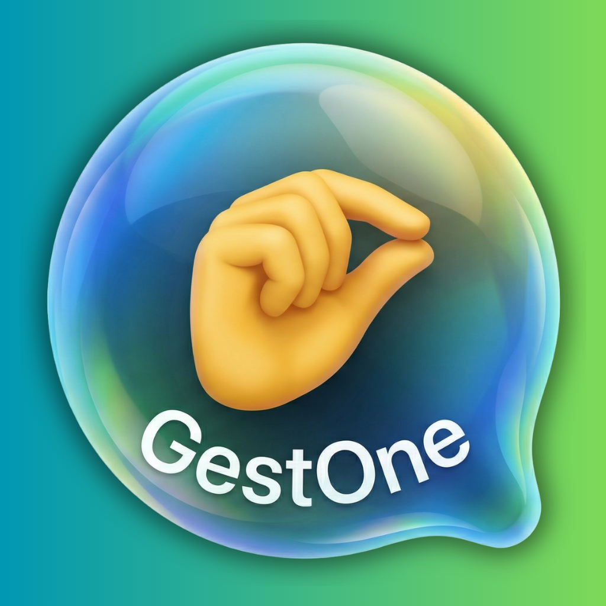

# GestOne




**GestOne** is a lightweight macOS menu-bar app that lets you control your Mac entirely with your hands, head, and voice — no touch, no keyboard, no mouse required.

It runs locally, starts instantly, and lives quietly in your menu bar until you need it.

---

## Features

| Feature | Description |
|---|---|
| **Zero-Latency Bufferless Camera** | Dedicated camera thread with direct frame grab — no buffering delay |
| **True 3D Pinch-to-Click** | Depth-aware index-thumb distance detection for natural, precise clicking |
| **Trackpad-like Momentum Scrolling** | V-sign gesture triggers smooth, inertia-based scroll |
| **Slouch / Posture Warning** | Detects forward head drift and notifies you to sit up straight |
| **Voice-Controlled Sleep Mode** | Say "uyku" or "sleep" to pause tracking hands-free |
| **Context-Aware Actions** | Actions adapt to the frontmost app (Safari, Keynote, Spotify, etc.) |
| **Auto-Calibration** | One-click pinch threshold calibration for your hand and lighting |
| **Mode Switching** | Instantly switch between Mouse, Gesture, and Head tracking modes |

---

## Installation — End Users

1. Go to the [**Releases**](../../releases) tab and download **GestOne.zip**
2. Unzip the archive
3. Move **GestOne.app** to your `/Applications` folder
4. Double-click to launch

On first launch, macOS will ask for:
- **Camera access** — required for hand and head tracking
- **Accessibility access** — required to move the cursor and send key events

Grant both permissions in **System Settings → Privacy & Security**, then relaunch the app.

> **Note:** If macOS says the app is from an unidentified developer, right-click the app → **Open** → **Open** to bypass Gatekeeper once.

---

## Installation — Developers

```bash
# 1. Clone the repo
git clone https://github.com/your-username/GestOne.git
cd GestOne

# 2. Create and activate a virtual environment
python -m venv .venv
source .venv/bin/activate

# 3. Install dependencies
pip install -r requirements.txt

# 4. Run directly
python app.py

# 5. Build a standalone .app bundle
chmod +x build.sh
./build.sh
```

The built app will appear in `dist/GestOne.app`.

---

## Usage & Gestures

### Mouse Mode (default)
| Gesture | Action |
|---|---|
| Move index fingertip | Move cursor |
| Pinch index + thumb | Left click (hold to drag) |
| Pinch twice quickly | Double click |
| V-sign (index + middle) moving up/down | Scroll |

### Gesture / Media Mode
| Gesture | Action |
|---|---|
| ✋ Open palm | Play / Pause |
| 👍 Thumbs up | Volume up |
| 👎 Thumbs down | Volume down |
| ✌️ Victory sign | Next track |

### Two-Hand Gestures (always active)
| Gesture | Action |
|---|---|
| Both fists closed | Mission Control |
| Two hands moving apart | Fullscreen |
| Two hands moving together | Minimize window |

### Head Mode
| Movement | Action |
|---|---|
| Turn head right | Next track |
| Turn head left | Previous track |

### Voice Commands
| Command | Action |
|---|---|
| "Fare" / "Mouse" | Switch to Mouse mode |
| "Jest" / "Gesture" | Switch to Gesture mode |
| "Kafa" / "Head" | Switch to Head mode |
| "Uyku" / "Sleep" | Pause GestOne |
| "Oynat" / "Play" | Play / Pause |
| "Sonraki" / "Next" | Next track |
| "Önceki" / "Previous" | Previous track |

---

## Menu Bar

Click the **🖐️** icon in the menu bar to:
- Switch modes
- Pause / resume tracking
- Run auto-calibration for pinch sensitivity
- Adjust mouse smoothness
- Quit

---

## Architecture

```
GestOne/
├── app.py                  # Entry point, menu-bar app, main control loop
├── config.py               # All thresholds, mode constants, defaults
├── build.sh                # PyInstaller build script
├── entitlements.plist      # macOS camera + mic entitlements
└── src/
    ├── core/
    │   ├── modes.py        # Mode manager (mouse / gesture / head)
    │   └── dispatcher.py   # Action dispatcher
    ├── detectors/
    │   ├── camera_source.py            # Dedicated capture thread
    │   ├── gesture_detector.py         # Single-hand MediaPipe gestures
    │   ├── hand_mouse_tracker.py       # Cursor position + pinch + scroll
    │   ├── two_hand_gesture_detector.py# Two-hand gestures
    │   ├── head_tracker.py             # Head yaw/pitch tracking
    │   └── voice_controller.py         # Speech recognition
    ├── controls/
    │   ├── mouse_controller.py         # Low-level mouse events
    │   └── media_controller.py         # Media key dispatch
    └── utils/
        ├── common.py                   # Cooldown, shared utilities
        ├── one_euro_filter.py          # 1€ filter for cursor smoothing
        └── config_persistence.py       # Save/load user overrides
```

---

## Requirements

- macOS 12 Monterey or later (Apple Silicon and Intel)
- Python 3.10+
- A built-in or external webcam
- Microphone (optional, for voice commands)

---

## License

MIT License. See [LICENSE](LICENSE) for details.
